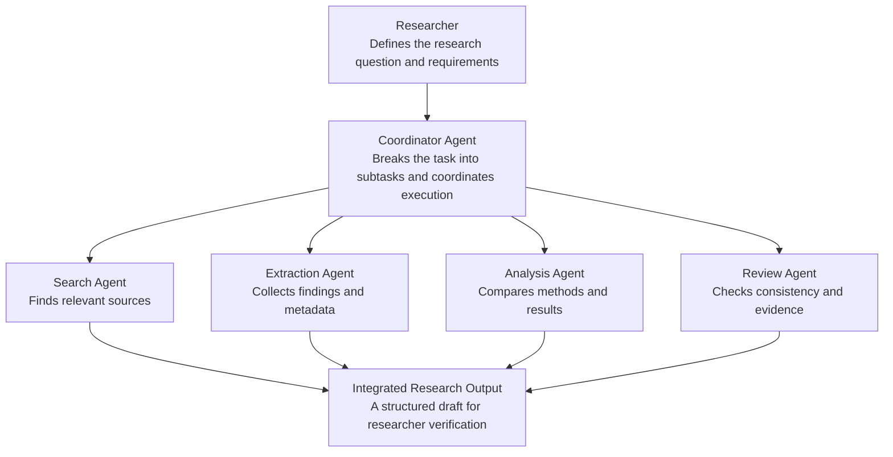

# 1.7 Applications and Importance of AI Agents

---

## 1.7.1 Introduction

> Artificial Intelligence (AI) agents are increasingly important in the development of intelligent systems that can perceive information, make decisions, use external tools, and perform tasks to achieve specified objectives. Unlike conventional software that follows a fixed sequence of instructions, an intelligent agent can select actions according to its current situation, available information, and defined goals. Depending on its design, it may also learn from experience, maintain memory, plan multi-step activities, and revise its behaviour when circumstances change.

The growing importance of AI agents is closely associated with advances in machine learning, deep learning, Large Language Models (LLMs), natural language processing, computer vision, robotics, and cloud computing. These technologies enable agents to interact with people and digital environments in increasingly flexible ways.

AI agents have applications across education, healthcare, finance, manufacturing, agriculture, cybersecurity, scientific research, transportation, and business automation. They can support routine operations, analyse large volumes of information, coordinate complex workflows, and assist human decision-making.

For example, an AI agent in a university may retrieve syllabus information, help students organise their study schedules, and answer questions using approved institutional documents. In healthcare, an agent may assist with administrative scheduling or summarise authorised clinical information for professional review. In manufacturing, an agent may monitor equipment data and recommend maintenance before a failure occurs.

The importance of AI agents therefore extends beyond automation. They provide a framework for building systems that combine perception, reasoning, planning, tool use, and feedback to solve practical problems.

---

## 1.7.2 Major Applications of AI Agents

---

### 1.7.2.1 AI Agents in Education

Education is an important application area for intelligent agents because teaching and learning involve information retrieval, personalised support, assessment, planning, and continuous feedback.

AI agents can support students, teachers, researchers, and university administrators by performing tasks that would otherwise require substantial manual effort.

**Major applications include:**

- **Intelligent tutoring:** Explaining concepts, generating practice exercises, and providing step-by-step guidance.
- **Personalised learning:** Recommending learning resources based on a student's progress and stated objectives.
- **Academic assistance:** Retrieving course information, explaining assignment requirements, and supporting revision planning.
- **Automated assessment support:** Checking objective questions, organising submissions, and assisting teachers with feedback.
- **Administrative automation:** Helping students find admission information, examination schedules, and institutional notices.
- **Research assistance:** Searching approved sources, organising references, extracting relevant information, and preparing literature-review outlines.

> [!EXAMPLE]
> **Example: University academic-support agent**
>
> Consider an agent developed for a B.Sc. Data Science and Artificial Intelligence programme. A student requests a study plan for an upcoming Python examination. The agent can retrieve the approved syllabus and examination schedule, identify the topics to be covered, generate a proposed revision timetable, and check the plan against the available time.
>
> The agent may also generate practice questions and track which topics the student has completed, if appropriate tracking features are enabled.

> [!IMPORTANT]
> Such an application can improve access to academic support and reduce repetitive administrative work. However, important information must be checked against official university sources, and teachers should retain responsibility for consequential academic decisions.

---

### 1.7.2.2 AI Agents in Healthcare

Healthcare involves large amounts of clinical information, complex workflows, time-sensitive decisions, and coordination among medical professionals. AI agents can assist with administrative tasks, information management, and selected clinical-support activities.

**Applications include:**

- **Appointment management:** Coordinating bookings, reminders, and schedule updates.
- **Clinical information retrieval:** Finding relevant information from authorised records and medical knowledge sources.
- **Medical documentation:** Preparing draft summaries and organising clinical notes for professional review.
- **Medical research:** Supporting literature searches and the organisation of research findings.
- **Medical imaging workflows:** Helping coordinate image-processing pipelines or flagging cases for expert review.
- **Hospital operations:** Assisting with resource scheduling, inventory monitoring, and workflow coordination.

> [!EXAMPLE]
> **Example: Hospital administrative agent**
>
> An agent may receive a request to arrange a follow-up appointment. It checks permitted scheduling information, identifies available slots, proposes suitable options, and prepares a booking for confirmation according to hospital policy.
>
> This reduces administrative effort while keeping the patient and healthcare staff involved in important decisions.

> [!WARNING]
> AI agents must not be treated as independent substitutes for qualified medical professionals. Clinical applications require appropriate validation, privacy protection, security controls, and human oversight.

---

### 1.7.2.3 AI Agents in Finance and Banking

Financial services require rapid information processing, transaction monitoring, customer support, risk assessment, and compliance with regulatory requirements. AI agents can help coordinate these activities when integrated with authorised financial systems.

**Key applications include:**

- **Customer support:** Answering account-related questions within authorised access limits.
- **Fraud detection support:** Analysing transaction patterns and flagging suspicious activity.
- **Financial document processing:** Extracting information from invoices, statements, and other documents.
- **Risk analysis:** Collecting relevant indicators and preparing summaries for analysts.
- **Compliance assistance:** Checking records against specified rules and preparing exceptions for review.
- **Workflow automation:** Coordinating routine reporting and document-verification activities.

> [!EXAMPLE]
> **Example: Transaction-monitoring agent**
>
> A transaction-monitoring agent analyses authorised transaction records and identifies activity that differs from expected patterns. When a potential anomaly is detected, it collects supporting information and sends an alert to a fraud analyst.
>
> The agent assists with detection and investigation, but a flagged transaction is not necessarily fraudulent. Financial actions such as blocking accounts or transferring funds should be subject to appropriate authorisation, security controls, and regulatory requirements.

---

### 1.7.2.4 AI Agents in Manufacturing and Industry 4.0

Manufacturing environments generate continuous streams of information from machines, sensors, production systems, and supply-chain operations. AI agents can use this information to coordinate processes, detect anomalies, and improve operational efficiency.

**Applications include:**

- **Predictive maintenance:** Analysing equipment data to identify possible failures.
- **Production scheduling:** Coordinating production activities and resource availability.
- **Quality inspection:** Supporting the identification of defects using computer vision.
- **Inventory management:** Monitoring stock levels and preparing replenishment recommendations.
- **Robotic control:** Coordinating robot actions within defined operational constraints.
- **Energy management:** Recommending changes to reduce energy consumption while meeting production requirements.

> [!EXAMPLE]
> **Example: Predictive-maintenance agent**
>
> An agent monitors temperature, vibration, and operating-time data from industrial equipment. It identifies an unusual pattern, compares the observation with maintenance records, estimates whether inspection may be required, and generates a maintenance recommendation.
>
> This can help reduce unexpected downtime and improve maintenance planning. Physical machine-control actions, however, require robust safety mechanisms and must not override established industrial protection systems.

---

### 1.7.2.5 AI Agents in Agriculture

Agriculture increasingly uses digital technologies to monitor crops, manage irrigation, assess soil conditions, and support resource allocation. Intelligent agents can combine environmental observations with predictive models and operational constraints to assist farmers.

**Applications include:**

- **Smart irrigation:** Recommending watering schedules based on soil moisture and weather information.
- **Crop monitoring:** Analysing images and sensor observations to identify possible crop stress.
- **Pest and disease detection:** Flagging patterns that may indicate crop-health problems.
- **Weather-informed planning:** Supporting decisions about sowing, irrigation, and harvesting.
- **Agricultural resource management:** Coordinating water, fertiliser, and equipment use.
- **Autonomous agricultural equipment:** Supporting navigation and task execution within defined safety limits.

> [!EXAMPLE]
> **Example: Smart irrigation agent**
>
> An irrigation agent collects soil-moisture readings and checks weather forecasts. If the soil is dry and rainfall is unlikely, it may recommend irrigation or activate a permitted irrigation system according to the configured policy.
>
> The agent can help reduce unnecessary water use, but its recommendations depend on sensor accuracy, crop requirements, and local environmental conditions.

---

### 1.7.2.6 AI Agents in Transportation and Logistics

Transportation and logistics involve routing, scheduling, fleet management, delivery tracking, and resource allocation. These activities often require decisions to be revised as traffic, demand, weather, and delivery conditions change.

**Applications include:**

- **Route optimisation:** Selecting suitable routes based on distance, time, cost, and restrictions.
- **Fleet management:** Coordinating vehicles, drivers, maintenance, and delivery assignments.
- **Warehouse automation:** Supporting inventory movement and robotic task allocation.
- **Delivery tracking:** Monitoring progress and identifying delays.
- **Supply-chain coordination:** Collecting information from suppliers, warehouses, and transport systems.
- **Demand forecasting support:** Preparing inventory and distribution recommendations using forecast information.

> [!EXAMPLE]
> **Example: Intelligent delivery-planning agent**
>
> An agent receives a set of delivery destinations, vehicle capacities, delivery deadlines, and available route information. It prepares a delivery schedule and proposes routes that satisfy the applicable constraints.
>
> If a road becomes unavailable, the agent can revise the proposed plan using updated information. Actual route execution and vehicle control must remain subject to relevant safety rules and operational constraints.

---

### 1.7.2.7 AI Agents in Cybersecurity

Cybersecurity environments contain large numbers of system logs, network events, authentication records, alerts, and potential threats. Intelligent agents can assist security teams by gathering information, identifying suspicious patterns, and coordinating authorised responses.

**Applications include:**

- **Threat detection:** Identifying suspicious network or system activity.
- **Security-log analysis:** Correlating events across multiple data sources.
- **Incident triage:** Grouping alerts and prioritising cases for investigation.
- **Vulnerability management:** Collecting vulnerability information and organising remediation tasks.
- **Access monitoring:** Identifying unusual authentication patterns.
- **Incident-response coordination:** Preparing reports and initiating explicitly authorised containment workflows.

> [!EXAMPLE]
> **Example: Security-monitoring agent**
>
> An agent observes authentication logs and detects repeated failed login attempts followed by unusual access activity. It gathers relevant evidence, assesses the event against security policies, and alerts the security team.
>
> Where the system is explicitly authorised to do so, it may perform a limited containment action. High-impact actions should require suitable controls, and every action should be recorded for auditing.

---

### 1.7.2.8 AI Agents in Business and Customer Service

Organisations perform many repetitive tasks involving communication, documentation, scheduling, customer requests, and information retrieval. AI agents can coordinate these workflows by connecting language-based interaction with business applications.

**Applications include:**

- **Customer support:** Retrieving relevant policy information and preparing responses.
- **Sales assistance:** Organising customer enquiries and preparing follow-up recommendations.
- **Document processing:** Extracting data from forms, reports, and invoices.
- **Human-resource support:** Answering routine policy questions and assisting with scheduling.
- **Project coordination:** Tracking tasks, deadlines, dependencies, and progress.
- **Business intelligence:** Gathering data and preparing analytical summaries.

> [!EXAMPLE]
> **Example: Invoice-processing agent**
>
> An invoice-processing agent receives an invoice, extracts the supplier and invoice details, checks required fields, compares the information with authorised purchase records, and flags discrepancies.
>
> It can prepare a payment request, but the release of funds should follow the organisation's financial approval process.

---

### 1.7.2.9 AI Agents in Scientific Research

Scientific research often requires collecting evidence, processing data, testing hypotheses, conducting experiments, and documenting results. AI agents can assist with these activities by coordinating multiple computational tools and information sources.

**Applications include:**

- **Literature discovery:** Identifying potentially relevant publications.
- **Research-data analysis:** Coordinating data-cleaning, statistical analysis, and visualisation tools.
- **Hypothesis exploration:** Generating candidate hypotheses for human evaluation.
- **Computational experiments:** Running permitted simulations or analysis pipelines.
- **Scientific documentation:** Preparing draft reports and organising references.
- **Reproducibility support:** Recording parameters, code versions, data sources, and experimental results.

> [!EXAMPLE]
> **Example: AI-assisted medical-image research**
>
> In a medical-image segmentation project, an agent may help organise image files, validate dataset structure, launch an authorised training workflow, collect evaluation metrics, and summarise model performance.
>
> For example, in a microscopy-image segmentation project, it might coordinate preprocessing, model training, and evaluation of predicted masks against ground-truth masks. The researcher must still verify data integrity, experimental design, metric calculations, and scientific conclusions.
>
> AI agents can accelerate research workflows, but generated findings should not be accepted without appropriate validation and reproducibility checks.

---

## 1.7.3 Importance of AI Agents

The applications described above demonstrate where AI agents can be used. Their broader importance lies in the capabilities they provide to intelligent information systems.

| # | Importance | Description |
|---|---|---|
| 1 | **Automation of complex tasks** | Agents can coordinate multiple operations, such as retrieving information, validating data, preparing reports, and tracking task completion. This is particularly useful when a workflow involves several applications or decision points. |
| 2 | **Improved operational efficiency** | Automating repetitive and information-intensive activities can reduce manual effort and help organisations use their resources more effectively. Actual efficiency gains depend on task complexity, integration quality, and error rates. |
| 3 | **Data-informed decision-making** | Agents can collect information from approved sources, compare alternatives, and prepare recommendations using defined objectives and performance measures. |
| 4 | **Personalisation** | When appropriately configured, agents can tailor explanations, recommendations, and workflows to individual requirements, preferences, or operating contexts. |
| 5 | **Continuous monitoring** | Agents can observe changing conditions and respond to relevant events without waiting for a user to initiate every step, subject to system permissions and operational limits. |
| 6 | **Integration of heterogeneous systems** | Agents can connect information sources, APIs, databases, software tools, and other services into a coordinated workflow. |
| 7 | **Adaptation to changing conditions** | Agents with suitable models, state representations, or learning mechanisms can revise their actions when the environment or task requirements change. |
| 8 | **Human–AI collaboration** | Agents can assist people by gathering evidence, proposing actions, and performing authorised routine operations, allowing human experts to concentrate on tasks requiring judgement, creativity, or accountability. |

> [!NOTE]
> These benefits are potential outcomes rather than guarantees. Poorly designed agents can introduce new errors, increase operating costs, or automate an inefficient process. Their value must be assessed against measurable objectives.

---

## 1.7.4 Traditional Automation versus AI-Agent-Based Automation

Traditional automation and AI-agent-based automation can both reduce manual work, but they generally differ in how they handle instructions, changing conditions, and decisions.

| Feature | Traditional automation | AI-agent-based automation |
|---|---|---|
| **Execution** | Usually follows predefined workflows | May select among actions based on context |
| **Input handling** | Often requires structured inputs | May interpret structured and unstructured inputs |
| **Decision-making** | Primarily fixed rules and conditions | May combine rules, models, planning, and learned policies |
| **Adaptation** | Usually requires explicit workflow changes | May revise actions using updated observations or feedback |
| **Tool interaction** | Often predefined integrations | May coordinate multiple permitted tools dynamically |
| **Error handling** | Commonly uses specified exceptions | May diagnose failures and select permitted recovery actions |
| **Predictability** | Often high in stable, well-defined workflows | Depends on models, tools, planning, and constraints |
| **Oversight** | Depends on workflow risk | Particularly important when agents select consequential actions |

For example, a traditional invoice workflow may process documents through a fixed series of extraction and validation steps. An agent-based workflow may additionally decide which approved validation tool to use, investigate a discrepancy, and prepare a recommendation for review.

The two approaches are complementary. For stable, highly regulated processes, conventional automation may be preferable. An AI agent may add value when tasks involve variable inputs, multiple information sources, or decisions that cannot be fully specified in advance.

---

## 1.7.5 AI Agents and Multi-Agent Systems

Many complex problems can be divided into smaller tasks. In such cases, multiple specialised agents may collaborate within a multi-agent system (MAS).

A multi-agent system contains two or more agents that interact to perform individual or shared tasks. Depending on the architecture, they may coordinate through messages, shared memory, common objectives, or a central controller.

### Example: Multi-agent academic research system

> [!NOTE]
> In this example, the coordinator distributes work among specialised agents and integrates their outputs. The review agent can identify unsupported claims or missing references, but the final research output still requires verification by the researcher.

### Benefits of multi-agent systems

- [x] Division of complex tasks into manageable subtasks.
- [x] Specialisation of individual agents.
- [x] Parallel execution of suitable operations.
- [x] Coordination of multiple tools and information sources.
- [x] Modular development and maintenance.

### Challenges of multi-agent systems

- [ ] Communication and coordination overhead.
- [ ] Inconsistent outputs from different agents.
- [ ] Duplication of work.
- [ ] Error propagation between agents.
- [ ] Increased computational costs.
- [ ] Difficulty evaluating the complete system.

> [!IMPORTANT]
> Adding more agents does not automatically improve performance. A multi-agent architecture is most useful when task decomposition and coordination provide measurable benefits over a simpler single-agent solution.

---

## 1.7.6 Limitations and Challenges of AI Agents

Despite their potential, AI agents introduce important technical, operational, and ethical challenges.

| Challenge | Description | Possible mitigation |
|---|---|---|
| **Incorrect outputs** | An agent may produce inaccurate information or an unsuitable recommendation | Validate outputs and use reliable sources |
| **Uncontrolled actions** | An agent may take actions beyond the intended scope if permissions are poorly designed | Apply least-privilege access and action constraints |
| **Privacy risks** | Personal or confidential data may be exposed or retained unnecessarily | Minimise data collection and enforce access controls |
| **Security threats** | Malicious inputs may manipulate an agent or misuse its tools | Validate inputs, isolate tools, and apply security testing |
| **Cost and latency** | Repeated model calls and tool interactions may be expensive or slow | Use efficient workflows, bounded retries, and task-specific models |
| **Unreliable external services** | APIs, databases, or websites may be unavailable or return unexpected data | Implement error handling, validation, and controlled fallbacks |
| **Bias and fairness** | Decisions may reflect biased data or inappropriate criteria | Evaluate outcomes and monitor for disparate impacts |
| **Limited accountability** | Automated decisions may be difficult to explain or audit | Maintain logs, document policies, and assign responsibility |
| **Evaluation difficulty** | Complex workflows may succeed at some steps but fail overall | Test end-to-end performance and track task-level metrics |

> [!IMPORTANT]
> A responsible AI-agent system should be designed with clear goals, well-defined permissions, reliable information sources, appropriate evaluation procedures, and human oversight proportionate to the consequences of failure.

---

## 1.7.7 Future Scope of AI Agents

The development of AI agents is expected to continue across several interconnected areas of research and application.

| # | Direction | Description |
|---|---|---|
| 1 | **More capable agentic AI systems** | Agents are increasingly being designed to coordinate reasoning, planning, tool use, and feedback within multi-step workflows. Future systems will require more reliable execution and better handling of unexpected conditions. |
| 2 | **Personalised and context-aware assistance** | Agents may provide more tailored support by combining user instructions, relevant context, and explicitly managed memory, while respecting privacy and user preferences. |
| 3 | **Integration with robotics and the physical world** | The combination of language models, perception, planning, and robotic control may enable more flexible assistance in manufacturing, logistics, laboratories, and selected domestic tasks. |
| 4 | **Multi-agent collaboration** | Specialised agents may collaborate on software development, research, business operations, and scientific analysis. Effective coordination and verification will remain essential. |
| 5 | **Human-centred and trustworthy AI** | Future systems will need stronger mechanisms for explainability, security, privacy, fairness, evaluation, and meaningful human control. |
| 6 | **Domain-specific intelligent agents** | Specialised agents may be developed for fields such as medical research, legal document analysis, education, agriculture, and industrial maintenance. Domain-specific constraints and expert evaluation will be essential to their reliability. |

> [!NOTE]
> These directions represent active development areas, not guaranteed outcomes. Their success will depend on technical progress, careful evaluation, practical usefulness, and responsible deployment.

---

## 1.7.8 Conclusion

AI agents provide a flexible approach to building intelligent applications that combine information processing, decision-making, planning, and action. Their applications span education, healthcare, finance, manufacturing, agriculture, transportation, cybersecurity, business operations, and scientific research.

Their importance lies in their potential to coordinate complex workflows, support data-informed decisions, personalise assistance, and automate appropriate tasks. When integrated with external tools and other agents, they can extend beyond isolated question answering to support multi-step activities.

However, the benefits of AI agents depend on careful system design. Reliability, security, privacy, transparency, cost, and human oversight must be considered alongside performance and autonomy. AI agents should support human expertise and operate within clearly defined boundaries rather than being assumed to make every decision correctly.

> [!TIP]
> **In summary**, AI agents are an important building block for modern intelligent applications because they provide a framework for connecting AI capabilities with goal-directed action in real-world environments.

---

**End of Section 1.7**

