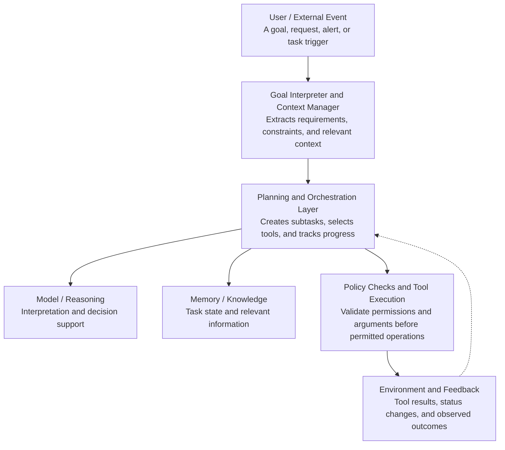

# 1.8 Evolution Toward Agentic AI

<div align="center">


</div>

---

## 1.8.1 Introduction

> Artificial Intelligence (AI) has evolved from systems designed to follow explicitly programmed rules into increasingly capable systems that can learn from data, understand natural language, generate content, use external tools, and coordinate multiple steps to accomplish complex objectives. This progression has created the foundation for Agentic AI—an approach in which AI systems are designed not only to generate responses but also to pursue goals through planning, decision-making, action, and feedback.

Traditional AI applications generally focus on specific tasks. A classification model predicts whether an email is spam, a recommendation system suggests products, and a chatbot responds to user questions. These systems can be highly effective, but they do not necessarily determine what steps are required to achieve a broader objective or independently execute those steps.

Agentic AI extends these capabilities by introducing goal-directed behaviour and action-oriented workflows. An agentic system may interpret a user's objective, break it into subtasks, select suitable tools, execute actions, evaluate the results, and revise its approach when necessary.

For example, consider a user who asks an AI system to prepare a research report on applications of deep learning in medical imaging. A conventional generative AI system might produce a report based on the information available to it. An agentic system could go further by planning a research workflow, searching authorised scholarly sources, extracting relevant findings, organising references, comparing evidence, drafting sections, and checking the completed report against predefined requirements. Human review may still be required, especially before publication or other consequential actions.

The evolution toward Agentic AI is therefore not simply an increase in model size or language capability. It represents a shift from AI that primarily produces outputs to AI systems that can organise and execute sequences of actions toward defined goals.

---

## 1.8.2 What Is Agentic AI?

Agentic AI refers to AI systems that exhibit a degree of goal-directed behaviour by selecting and coordinating actions to achieve specified objectives. Depending on their design, these systems may use planning, memory, reasoning, external tools, environmental feedback, and interaction with other agents.

There is no single architecture that defines every agentic system. Some systems use explicit planning algorithms, while others combine large language models (LLMs) with tools, state management, workflow engines, and verification mechanisms.

A practical agentic AI system commonly includes the following capabilities:

- [x] **Goal interpretation:** Understand the objective and identify the expected result.
- [x] **Task decomposition:** Divide a complex objective into manageable subtasks.
- [x] **Planning:** Determine a sequence of steps that may lead to the desired outcome.
- [x] **Tool use:** Interact with permitted software, APIs, databases, or other resources.
- [x] **Memory and state management:** Maintain relevant information about the task and its progress.
- [x] **Action execution:** Carry out authorised operations in the environment.
- [x] **Feedback and evaluation:** Check results and determine whether further action is needed.
- [x] **Adaptation:** Revise the plan when new information or unexpected outcomes arise.

These capabilities vary across systems. A simple agent may only select an action from a set of predefined choices, whereas a more advanced agentic system may plan dynamically, use multiple tools, and coordinate specialised agents.

### Core principle of Agentic AI

| Step | Description |
|---|---|
| **Define the goal** | Establish the intended outcome and constraints. |
| **Plan and reason** | Select steps, resources, and tools. |
| **Execute authorised actions** | Interact with tools or the environment. |
| **Observe and evaluate** | Compare the outcome with the goal. |
| **Complete or revise** | Finish when requirements are met; otherwise, continue within defined limits. |

*Figure 1.8.1. A general goal–plan–act–evaluate cycle for Agentic AI.*

> [!NOTE]
> The diagram illustrates a common pattern rather than a mandatory architecture. Real systems may repeat individual steps, perform them in parallel, request clarification, or stop and seek human approval when an action is uncertain or sensitive.

---

## 1.8.3 Historical Evolution Toward Agentic AI

The development of Agentic AI is the result of several decades of progress in artificial intelligence, machine learning, planning, knowledge representation, natural language processing, and software engineering. Each stage introduced capabilities that later became important for autonomous and semi-autonomous AI systems.

> [!IMPORTANT]
> The transition should not be understood as a complete replacement of earlier technologies. Rule-based systems, search algorithms, machine learning models, planning methods, and modern foundation models continue to coexist in contemporary agent architectures.

### Stage 1: Rule-Based and Symbolic AI

Early AI systems relied heavily on explicitly represented knowledge, logical rules, and symbolic reasoning. Developers encoded relationships and decision rules that enabled a system to solve particular problems.

A simple rule-based system might contain the following rules:

```python
temperature = 39
cough = True
if temperature > 38 and cough:
    print("Recommend medical assessment")
```

The program evaluates predefined conditions and produces an output. It does not independently formulate a plan, search for additional information, or execute a multi-step workflow.

> [!TIP]
> **Contribution to Agentic AI:** Rule-based systems established the importance of explicit knowledge representation, logical decision-making, and interpretable conditions. These techniques remain useful in modern agents for enforcing policies, validating actions, and defining operational constraints.

### Stage 2: Expert Systems

During the development of expert systems, AI researchers attempted to reproduce aspects of specialised human expertise. Systems used knowledge bases and inference engines to reason about particular domains, including medicine, engineering, and industrial troubleshooting.

An expert system could infer a possible fault from observed symptoms by applying rules supplied by domain experts.

However, such systems often depended on manually encoded knowledge and had limited flexibility outside their intended domains. Updating their knowledge bases and managing unexpected situations could also be difficult.

> [!TIP]
> **Contribution to Agentic AI:** Expert systems demonstrated how domain knowledge and reasoning could be separated from the execution of individual tasks. Modern agents can incorporate similar rule-based components to support domain-specific decisions and enforce constraints.

### Stage 3: Planning, Search, and Autonomous Agents

AI research increasingly explored systems capable of selecting actions to achieve desired states. Classical planning approaches represented problems in terms of initial states, possible actions, constraints, and goal states.

For example, a delivery-planning agent might need to transport a package from location A to location D. It could evaluate available routes and select a sequence of movements that satisfies distance, time, or resource constraints.

A simplified planning problem can be represented as:

```
Initial State ──[Actions]──> Goal State
```

Unlike a fixed sequence of instructions, a planning system may select different action sequences depending on the initial state and available options.

> [!TIP]
> **Contribution to Agentic AI:** Planning research introduced important concepts such as action selection, goal states, state transitions, search strategies, and the evaluation of alternative plans. These concepts underpin many contemporary agent workflows.

### Stage 4: Machine Learning and Reinforcement Learning

Machine learning enabled AI systems to discover patterns from data rather than relying exclusively on manually written rules. Reinforcement learning extended this approach by allowing an agent to learn a policy through interactions with an environment.

An agent receives observations, chooses actions, and obtains rewards or penalties. Through training, it seeks to improve its long-term performance.

A common objective is to maximise expected cumulative reward:

```
J(π) = E_π [ Σₜ₌₀ᵀ γᵗ rₜ ]
```

where:

- `π` represents the agent's policy.
- `r_t` is the reward at time `t`.
- `γ` is a discount factor.
- `T` is the time horizon.

For example, a simulated robot may learn to navigate an environment while avoiding obstacles and minimising unnecessary movements.

> [!TIP]
> **Contribution to Agentic AI:** Machine learning provided mechanisms for adapting decisions to data and experience. Reinforcement learning contributed methods for sequential decision-making and optimising behaviour over time. However, learning from interaction does not automatically imply broad autonomy; the environment, objective, and action space may remain tightly controlled.

### Stage 5: Deep Learning and Representation Learning

Deep learning significantly improved the ability of AI systems to process complex information, including images, speech, text, and sensor data. Neural networks learned useful representations from large datasets and supported applications such as image recognition, speech recognition, and language understanding.

For example, an industrial monitoring system could use a neural network to identify visible defects in manufactured components. The prediction could then become an input to a separate decision-making or workflow system.

> [!TIP]
> **Contribution to Agentic AI:** Deep learning expanded the range of information that AI systems could perceive and interpret. This helped create the perception and information-processing capabilities needed by agents operating in complex digital and physical environments.

### Stage 6: Transformers and Large Language Models

The transformer architecture, introduced in 2017, became a major foundation for modern language models. Large language models (LLMs) subsequently demonstrated increasingly capable language generation, instruction following, summarisation, coding assistance, and contextual reasoning.

An LLM can interpret a natural-language request such as:

> Analyse the supplied dataset, identify missing values, generate summary statistics, and recommend suitable visualisations.

A language model can help interpret the request and produce code or a proposed sequence of operations. Nevertheless, generating a plausible plan is not the same as executing it successfully. Actual execution requires an appropriate runtime or tool, access permissions, and mechanisms for inspecting results.

> [!TIP]
> **Contribution to Agentic AI:** LLMs made natural-language interaction a flexible interface for specifying goals, interpreting instructions, proposing plans, and selecting tools. They can serve as reasoning or orchestration components within larger systems, although their outputs may be inaccurate and should be verified.

### Stage 7: Tool-Using LLMs and Workflow-Oriented Agents

The next important development was the integration of language models with external tools. Instead of returning only text, a system could select a permitted function, supply arguments, receive the result, and use that result to determine the next step.

Examples of tools include:

- Search and retrieval systems.
- Python interpreters and computational environments.
- Databases and document repositories.
- Calendar and email services.
- Business software and approved APIs.
- Monitoring and analytics platforms.

Consider an agent tasked with analysing student enrolment data. It might retrieve an authorised spreadsheet, inspect the available columns, run statistical calculations, generate charts, and prepare a summary. Each tool performs a concrete operation that can be inspected independently of the language model's explanation.

> [!TIP]
> **Contribution to Agentic AI:** Tool integration connects language-based reasoning with external operations. It enables systems to move beyond generating instructions toward carrying out multi-step tasks. The quality of the result depends on tool reliability, permission boundaries, validation, and the agent's ability to interpret returned information.

### Stage 8: Multi-Agent Systems and Collaborative Agentic AI

More complex tasks may benefit from several specialised agents rather than one agent performing every operation. A multi-agent system consists of multiple agents that interact, cooperate, negotiate, or compete within a shared problem space.

For example, a research workflow could assign separate responsibilities to agents for source discovery, evidence extraction, analysis, and quality review. A coordinating component could integrate their results into a single report.

Such arrangements can support specialisation and parallel processing. However, multiple agents can also introduce communication overhead, duplicated work, inconsistent conclusions, and error propagation. Adding agents does not guarantee better performance.

> [!TIP]
> **Contribution to Agentic AI:** Multi-agent research provides mechanisms for distributing work across specialised components and coordinating decisions. Contemporary agentic systems can combine these mechanisms with LLMs, conventional algorithms, and external tools.

---

## 1.8.4 Timeline of the Evolution Toward Agentic AI

| Period | Stage | Key developments |
|---|---|---|
| 1. 1950s–1970s | **Foundations and symbolic reasoning** | Logical reasoning, search, problem-solving, and early AI programs. |
| 2. 1970s–1980s | **Expert systems** | Knowledge bases, inference engines, and specialised decision support. |
| 3. 1980s–2000s | **Planning and autonomous-agent research** | Goal states, action sequences, agent environments, and autonomous control. |
| 4. 1990s–2010s | **Statistical machine learning** | Data-driven prediction, adaptive models, and reinforcement learning. |
| 5. 2010s | **Deep learning advances** | Improved perception, representation learning, and complex data processing. |
| 6. 2017 onward | **Transformers and foundation models** | Powerful language and multimodal capabilities that support instruction following and reasoning tasks. |
| 7. 2020s onward | **Tool-using and agentic AI systems** | Integration of models, tools, planning, memory, feedback, orchestration, and human oversight. |

*Figure 1.8.2. A simplified historical timeline. The periods overlap; agent research predates modern LLMs, and current systems combine ideas from multiple generations of AI.*

> [!IMPORTANT]
> The timeline highlights a key distinction: Agentic AI is a convergence of earlier AI capabilities rather than a technology that emerged entirely from large language models. Autonomous agents and automated planning have a long research history. Recent foundation models have made it easier to construct agents that can interpret flexible natural-language goals and use a broad range of digital tools.

---

## 1.8.5 From Generative AI to Agentic AI

Generative AI and Agentic AI are closely related, but they describe different aspects of an AI system.

Generative AI focuses on creating outputs, such as text, images, audio, video, or code. Agentic AI focuses on pursuing objectives through coordinated actions. A single application may combine both capabilities.

Consider a university department that wants to prepare a semester-wise analysis of student performance.

A generative AI application might draft a report from supplied statistics. An agentic system could perform a larger workflow by retrieving authorised data, checking its structure, calculating summaries, creating visualisations, drafting interpretations, and checking the report against a required template.

The distinction is illustrated below.

| Generative AI | Agentic AI |
|---|---|
| Receives a prompt and generates a response or other content. | Interprets an objective, coordinates steps, uses tools, and checks outcomes. |
| **Typical result:** a draft report, code snippet, summary, or image. | **Typical result:** an executed workflow with verifiable intermediate outputs. |

*Figure 1.8.3. Generating an output and executing a workflow are different capabilities, although one system can provide both.*

| Dimension | Generative AI application | Agentic AI application |
|---|---|---|
| **Primary focus** | Content generation | Goal-directed task execution |
| **Input** | Prompt or contextual information | Goal, constraints, and environment state |
| **Processing** | Generates a response or artefact | May plan, act, observe, and revise |
| **External tools** | Optional | Often important for practical task completion |
| **Multi-step tasks** | Can describe the steps | Can coordinate and execute steps when appropriately equipped |
| **Feedback** | May respond to user corrections | May evaluate tool results and adjust its plan |
| **Autonomy** | Varies by application | Designed to support some degree of independent action |
| **Verification** | Depends on the application | Can incorporate explicit checks and completion criteria |

> [!NOTE]
> These distinctions are not absolute. A generative AI application can run tools, and an agent can use a non-generative model. The meaningful difference is the system's overall behaviour and architecture, not simply the name of the underlying model.

---

## 1.8.6 Core Architecture of an Agentic AI System

A contemporary agentic AI system often combines several components. Their exact arrangement depends on the application, the risk level, the tools available, and the degree of autonomy required.



*Figure 1.8.4. Conceptual architecture of an agentic AI system. Feedback may return to the planning layer, and policy checks may apply at multiple stages.*

The principal architectural components are described below.

| # | Component | Description |
|---|---|---|
| 1 | **Goal interpreter** | Converts a natural-language request or system event into an explicit objective. It identifies expected outputs, deadlines, constraints, and conditions that require clarification. |
| 2 | **Planning and orchestration layer** | Determines the order of operations, allocates subtasks, tracks progress, and decides when to continue, retry, or stop. Planning may be performed by an LLM, a conventional planner, a workflow engine, or a combination of these. |
| 3 | **Reasoning or model component** | Analyses the available context and helps select actions. An LLM may provide language understanding and flexible task decomposition, while specialised models can perform classification, prediction, or other domain-specific operations. |
| 4 | **Memory and knowledge management** | Maintains information relevant to the task. Short-term state may record completed steps and intermediate results; longer-term memory may store approved preferences or reusable knowledge. Memory should be relevant, controlled, and subject to appropriate privacy and retention policies. |
| 5 | **Tool interface** | Connects the agent to external resources, such as databases, search services, computational environments, and enterprise applications. Tool calls should use defined interfaces and validate inputs. |
| 6 | **Policy and execution controls** | Enforce access permissions, resource limits, safety requirements, and approval rules. These controls are particularly important when an agent can modify files, send messages, alter records, or trigger financial or operational transactions. |
| 7 | **Feedback and evaluation** | Compares observed outcomes with expected results. The agent may retry a failed operation, gather more information, modify its plan, or request human assistance. |

> [!IMPORTANT]
> A central design principle is that reasoning and execution should be distinguishable. A model may propose an action, but the surrounding system should determine whether that action is valid, permitted, and appropriate to execute.

---

## 1.8.7 A Practical Example: An Agentic Research Assistant

Suppose a postgraduate student asks:

> Prepare a literature review on deep learning methods for medical image segmentation, focusing on U-Net variants and transformer-based architectures.

An agentic research assistant could organise this request into a sequence of tasks.

### Example workflow

| Step | Task | Description |
|---|---|---|
| 1 | **Clarify the research scope** | Identify the date range, medical imaging modalities, required number of papers, and citation style. |
| 2 | **Search scholarly sources** | Query authorised academic databases and retrieve relevant publications and metadata. |
| 3 | **Filter and organise evidence** | Remove duplicates, identify relevant studies, and classify papers by model family, dataset, and application. |
| 4 | **Extract findings** | Collect methodological details and reported metrics, distinguishing authors' claims from independently verified results. |
| 5 | **Compare methods** | Organise evidence into themes such as skip connections, attention mechanisms, transformer encoders, and computational requirements. |
| 6 | **Draft the review** | Generate a structured synthesis with citations linked to retrieved sources. |
| 7 | **Validate and request review** | Check citation consistency, identify unsupported statements, flag missing evidence, and present the draft for researcher approval. |

The workflow illustrates the practical value of agentic design: a broad objective is converted into smaller, interdependent operations. The system can track which steps have been completed and use their outputs to inform later steps.

> [!WARNING]
> However, several limitations remain. Search tools may miss relevant publications; extracted metadata may be incorrect; papers may report metrics under incompatible experimental conditions; and generated text may misrepresent findings. Therefore, the agent should preserve source provenance and support human verification rather than treating its own draft as authoritative.

---

## 1.8.8 Levels of Agentic Capability

Agentic behaviour can be understood as a spectrum rather than a binary property. The following levels are a conceptual teaching framework, not an established universal industry standard.

| Level | Capability | Example |
|---|---|---|
| **Level 1: Reactive** | Responds to a specific input | Answers a student's question |
| **Level 2: Tool-assisted** | Invokes a tool to answer or complete a bounded task | Runs Python to calculate statistics |
| **Level 3: Workflow-oriented** | Executes multiple predefined or dynamically selected steps | Retrieves data, analyses it, and prepares a report |
| **Level 4: Adaptive and goal-directed** | Revises a plan in response to intermediate results | Retries a failed data query using an alternative method |
| **Level 5: Coordinated multi-agent** | Delegates tasks to specialised agents and integrates their results | Coordinates research, analysis, and review agents |

> [!NOTE]
> A higher level does not necessarily mean a better system. A simple reactive system may be more reliable, efficient, and appropriate for a narrow task than a complex autonomous system. The suitable degree of agency depends on task complexity, acceptable risk, cost, and the availability of verification.
>
> It is also important to distinguish autonomy from unrestricted authority. A system may independently execute low-risk analytical tasks while requiring explicit approval for actions that affect other people, confidential records, or financial resources.

---

## 1.8.9 Benefits and Opportunities of Agentic AI

The evolution toward Agentic AI offers several opportunities for modern applications.

| # | Benefit | Description |
|---|---|---|
| 1 | **Automation of complex workflows** | Agents can coordinate multiple operations that would otherwise require repeated human intervention. This is useful in document processing, data analysis, software development, research support, and administrative workflows. |
| 2 | **Context-aware decision support** | By combining current observations with relevant historical information, agents can help users evaluate options and make more informed decisions. In high-impact domains, these recommendations should remain subject to qualified human judgement. |
| 3 | **Integration across digital systems** | Agents can connect different services through approved APIs and tools. A single workflow may interact with a database, a spreadsheet, a reporting service, and a document-generation system. |
| 4 | **Adaptation to changing conditions** | Systems with feedback mechanisms can respond to missing information, failed tool calls, or unexpected outputs. This is more flexible than a rigid workflow that cannot respond to deviations. |
| 5 | **Specialisation and collaboration** | Multi-agent architectures can assign different responsibilities to specialised components. For example, a software-development workflow might separate code generation, test execution, and code review. |
| 6 | **Improved human-AI collaboration** | Agentic systems can handle routine and repetitive steps while people define objectives, resolve ambiguity, review consequential decisions, and exercise professional judgement. |

> [!CAUTION]
> These benefits are conditional rather than automatic. Effective deployment requires suitable tools, reliable data, careful evaluation, operational monitoring, and clearly defined limits on what the system may do.

---

## 1.8.10 Challenges in the Evolution Toward Agentic AI

The increased capacity to take action creates challenges beyond those associated with generating text alone.

| Challenge | Description | Possible mitigation |
|---|---|---|
| **Planning errors** | The agent selects an unsuitable or incomplete sequence of steps | Use explicit success criteria, planning constraints, and checkpoints |
| **Hallucinations** | A model generates unsupported claims or invalid tool arguments | Verify outputs against trusted sources and validate arguments |
| **Error propagation** | An early mistake affects subsequent steps | Check intermediate results and maintain source provenance |
| **Excessive autonomy** | The system performs actions beyond the intended scope | Apply least-privilege access, approval gates, and bounded permissions |
| **Prompt injection** | Untrusted content attempts to manipulate the agent's behaviour | Treat retrieved content as untrusted and separate instructions from data |
| **Privacy and security** | Sensitive information is exposed through memory, logs, or external tools | Minimise data access, protect credentials, and enforce retention controls |
| **Cost and latency** | Repeated planning, model calls, and tool use consume time and resources | Set budgets, limits, timeouts, and stopping conditions |
| **Evaluation difficulty** | Success may be hard to measure across long, multi-step tasks | Test end-to-end outcomes, tool-use accuracy, robustness, and failure recovery |
| **Accountability** | It may be unclear who is responsible for an incorrect action | Define human responsibility, audit trails, and escalation procedures |

> [!WARNING]
> A particularly important concern is **error amplification**. In a simple question-answering application, an inaccurate response may mislead a user. In an agentic workflow, the same inaccurate interpretation could trigger additional incorrect actions. For instance, a faulty interpretation of a dataset might lead to incorrect analysis, misleading visualisations, and an inaccurate report.
>
> Consequently, systems should be designed to detect failures early, limit the consequences of incorrect actions, and provide clear mechanisms for human intervention.

---

## 1.8.11 Future Directions

The development of Agentic AI is likely to involve continued progress in several areas.

- **More reliable planning:** Better methods for breaking complex objectives into manageable tasks and verifying that plans satisfy constraints.
- **Improved tool use:** More robust interaction with databases, software applications, APIs, and physical systems.
- **Persistent and controlled memory:** Better mechanisms for retaining useful context while respecting privacy and deletion requirements.
- **Multimodal agents:** Systems that combine text, images, audio, video, and sensor data to operate in richer environments.
- **Multi-agent coordination:** Improved task allocation, communication, conflict resolution, and result integration.
- **Embodied AI and robotics:** Integration of perception, planning, and action in physical environments.
- **Trustworthy and auditable systems:** Better monitoring, evaluation, access control, and explanations of actions.
- **Human-agent collaboration:** Interfaces that make it easier for people to set goals, supervise progress, intervene, and approve important actions.

Progress in these areas will depend not only on advances in models but also on software architecture, data quality, security engineering, evaluation methods, and governance.

---

## 1.8.12 Conclusion

The evolution toward Agentic AI reflects a long progression in artificial intelligence, from symbolic reasoning and expert systems to planning, machine learning, deep learning, foundation models, tool-using systems, and multi-agent collaboration. Each stage has contributed capabilities that can be combined to create systems that pursue objectives through coordinated actions.

The defining idea is not that an AI system can produce a sophisticated answer, but that it can interpret a goal, organise a process, execute permitted actions, observe outcomes, and evaluate whether the objective has been achieved. The degree to which a system can perform these activities depends on its architecture, available tools, operational environment, and safeguards.

Agentic AI also introduces significant responsibilities. Systems that can act must be evaluated not only for the quality of their outputs but also for the reliability of their decisions, the safety of their actions, their compliance with permissions, and their ability to recover from errors.

For modern applications, the objective should therefore not be maximum autonomy in every situation. It should be **appropriate autonomy**—the right balance between independent task execution, verifiable outcomes, and human oversight.

This understanding provides the foundation for examining how agents are designed and implemented in practice, including their planning strategies, memory mechanisms, tool interfaces, and control structures.

---

<div align="center">

**End of Section 1.8**


</div>
