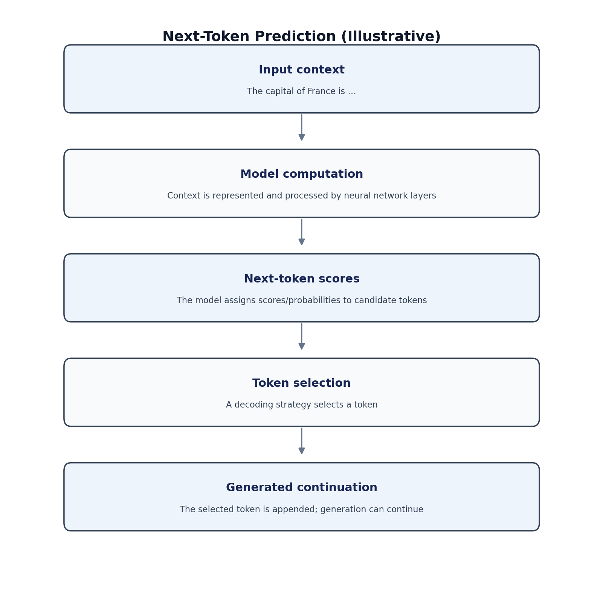
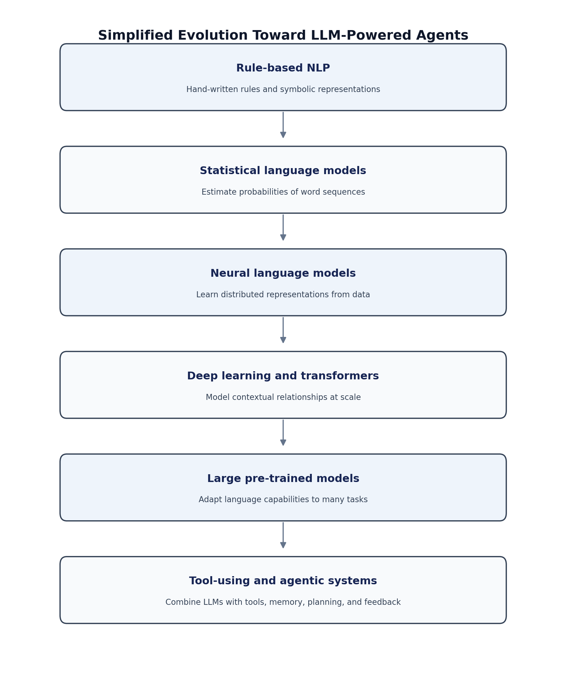
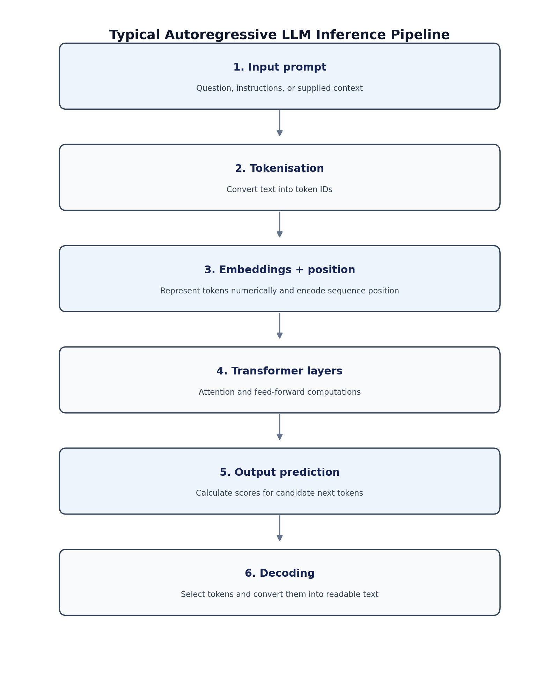
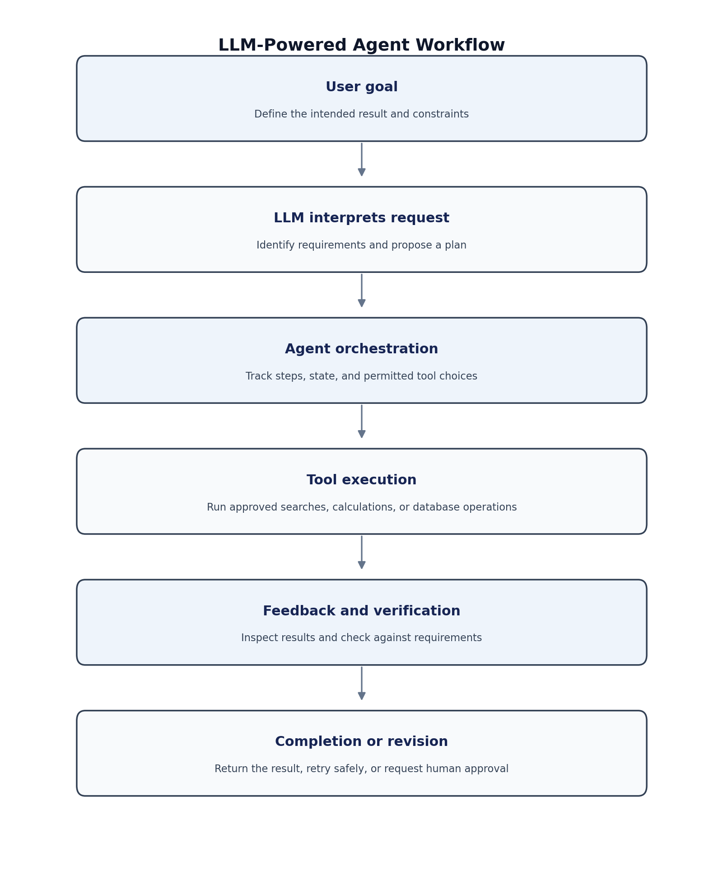

# 2.1 Introduction to Large Language Models (LLMs)

## 2.1.1 Introduction

Artificial Intelligence (AI) has undergone a significant transformation with the development of Large Language Models (LLMs). Earlier AI systems were often designed to perform narrowly defined tasks, such as classifying documents, detecting spam, recognising speech, or answering questions using predefined rules. Although these systems proved useful, they generally required specialised models, manually designed rules, or task-specific training procedures.

The emergence of LLMs has introduced a more flexible approach to artificial intelligence. By learning statistical patterns and contextual relationships from large collections of text and other data, these models can perform a broad range of language-related tasks using a common computational framework. They can generate text, summarise documents, translate languages, explain concepts, write computer programs, analyse supplied information, and assist users in solving complex problems.

LLMs have also changed how humans interact with computers. Instead of learning specialised commands or programming interfaces, users can communicate with an AI system through natural language. A student can request an explanation of a mathematical concept, a researcher can ask for a comparison of scientific methods, and a software developer can request assistance with debugging code.

For intelligent AI agents, LLMs can serve as language-processing and reasoning components in systems that interact with external tools, retrieve information, maintain task context, and coordinate multiple operations. When integrated with planning, memory, execution, and feedback mechanisms, an LLM can contribute to an AI agent capable of carrying out multi-step tasks.

However, an LLM should not be regarded as an infallible knowledge base or a fully autonomous agent by itself. Its responses can be incorrect, outdated, inconsistent, or unsupported by evidence. Reliable applications therefore require suitable data, verification mechanisms, access controls, and human oversight where appropriate.

## 2.1.2 What Is a Large Language Model?

A **Large Language Model (LLM)** is a machine learning model trained on large quantities of data to process and generate language by learning statistical and contextual relationships between tokens. Most contemporary LLMs are based on deep neural networks, particularly transformer architectures.

A *token* is a unit of text processed by a language model. Depending on the tokenizer, a token may represent a complete word, part of a word, punctuation, or another text unit.

Many generative LLMs use an autoregressive language-modelling objective:

\[
P(x_1,x_2,\ldots,x_n)=\prod_{t=1}^{n}P(x_t\mid x_1,\ldots,x_{t-1})
\]

where \(x_1,\ldots,x_n\) represent tokens and \(P(x_t\mid x_1,\ldots,x_{t-1})\) is the probability of the next token given preceding tokens. Other language models use different objectives, including masked-token prediction.

The model estimates likely continuations and generates text by repeatedly selecting tokens. This process can support question answering, summarisation, translation, and code generation. **Predicting plausible language is not the same as verifying factual truth**: a fluent answer can still be incorrect.

*Figure 2.1.1. Simplified illustration of next-token prediction.*

## 2.1.3 Why Are They Called Large Language Models?

The term combines three concepts:

| Term | Meaning |
|---|---|
| **Large** | Typically refers to substantial model capacity, often involving millions, billions, or more learned parameters, alongside extensive training resources. |
| **Language** | Language processing and generation are central objectives, although some modern models also process images, audio, video, or structured data. |
| **Model** | A learned mathematical system whose parameters encode patterns derived from training data. |

### A. Large

A parameter is a numerical value, such as a weight or bias, adjusted during training. Parameter count is one measure of scale, but it does not fully determine capability. Performance also depends on architecture, data quality, optimisation, context length, training procedures, and inference methods.

### B. Language

Language models learn relationships between tokens and sequences, including grammatical structure, semantic associations, and patterns found in their training data. These learned associations do not guarantee human-like understanding or factual accuracy.

### C. Model

A model can be represented abstractly as:

\[
\hat{y}=f_{\theta}(x)
\]

where \(x\) is the input, \(f_\theta\) is the model with learned parameters \(\theta\), and \(\hat{y}\) is the predicted output.

## 2.1.4 Evolution of Language Models

The development of LLMs reflects progress in computational linguistics, statistical modelling, neural networks, deep learning, and transformer architectures.

1. **Rule-based natural language processing:** Hand-written grammatical rules, dictionaries, and symbolic representations.
2. **Statistical language models:** Statistical methods such as n-gram models estimate the probability of word sequences.
3. **Neural language models:** Neural networks learn distributed representations and flexible relationships from examples.
4. **Word embeddings and recurrent networks:** Embeddings represent words as vectors, while recurrent networks process sequences.
5. **Transformer architecture:** Introduced in 2017, transformers use attention mechanisms to model relationships between tokens.
6. **Large-scale pre-trained models:** Models learn reusable language capabilities from extensive corpora and can be adapted to different tasks.
7. **Instruction-following and multimodal LLMs:** Additional training enables more effective instruction following and, in some models, processing of multiple modalities.
8. **LLM-powered agentic systems:** Language models are integrated with tools, memory, planning, and feedback.

*Figure 2.1.2. Simplified evolution of language modelling toward agentic systems. The stages overlap rather than completely replacing one another.*

## 2.1.5 Fundamental Characteristics of LLMs

### 1. Large-scale pre-training
Many LLMs are pre-trained on extensive text collections and other data sources. Data quality, diversity, licensing, and representativeness influence performance.

### 2. Contextual language processing
An LLM processes text in context. For example, *bank* has different meanings in “deposit money in a bank” and “sit on a river bank.”

### 3. Text generation
Generative LLMs produce text, explanations, summaries, emails, reports, and code in response to prompts.

### 4. Task flexibility
A single general-purpose model may summarise, translate, classify, extract information, and answer questions without separate task-specific models for every operation.

### 5. Prompt-based interaction
Natural-language instructions, constraints, examples, and contextual documents guide the model's output.

### 6. In-context learning
A model may adapt its response to examples supplied in the prompt without changing its underlying parameters.

### 7. Adaptability
Models can be adapted through supervised fine-tuning, preference optimisation, parameter-efficient methods, or integration with retrieval systems and tools.

### 8. Tool integration
Some LLM applications can select from predefined tools, such as calculators, search services, databases, or code interpreters. The surrounding application executes tool calls and returns results.

### 9. Probabilistic generation
Outputs depend on the model, context, and decoding configuration. A confident-sounding answer is not necessarily accurate.

## 2.1.6 How Does an LLM Work?

A typical autoregressive transformer-based LLM follows this inference pipeline:

*Figure 2.1.3. Simplified inference pipeline for a typical autoregressive transformer-based LLM.*

1. **Input prompt:** The user supplies a question, instruction, or context.
2. **Tokenisation:** Text is converted into token IDs using the model's tokenizer.
3. **Embeddings and positional information:** Tokens are mapped to numerical vectors, and sequence order is represented.
4. **Transformer processing:** Attention and feed-forward layers transform the representations.
5. **Output prediction:** The model calculates scores for possible next tokens.
6. **Decoding:** A token-selection procedure generates the next token. The process repeats until a stopping condition is reached.

A softmax function can convert token scores into a probability distribution:

\[
P(x_t=i\mid x_{<t})=\frac{e^{z_i}}{\sum_{j=1}^{V}e^{z_j}}
\]

Here, \(z_i\) is the score for token \(i\), and \(V\) is the vocabulary size. This is an illustrative formulation for next-token prediction; other model types may use different output procedures.

## 2.1.7 Types of Large Language Models

LLMs can be categorised by architecture, training objective, intended behaviour, and supported input modalities.

### A. Encoder-only models
Designed primarily to create contextual representations of input text. Common uses include classification, information extraction, and semantic representation. **BERT** is a well-known example.

### B. Decoder-only models
Commonly use causal attention to predict subsequent tokens based on preceding context. They are widely used for text generation, conversation, coding assistance, and LLM-based agents.

### C. Encoder–decoder models
Use an encoder to process input and a decoder to generate output. Common applications include translation and summarisation. **T5** is an example.

### D. Instruction-tuned models
Receive additional training intended to make responses more suitable for user instructions. Instruction tuning improves task following in many cases but does not guarantee accuracy or safety.

### E. Multimodal language models
Can process or generate information across multiple modalities, such as text, images, audio, or video, depending on the architecture.

| Category | Primary design | Common applications |
|---|---|---|
| Encoder-only | Contextual representation of input | Classification, extraction, semantic search |
| Decoder-only | Autoregressive generation | Conversation, text generation, coding |
| Encoder–decoder | Input-to-output sequence transformation | Translation, summarisation |
| Instruction-tuned | Better response to instructions | Assistants, task-oriented interfaces |
| Multimodal | Multiple information modalities | Image question answering, audio interaction |

These categories overlap. An instruction-tuned model may also be decoder-only and multimodal.

## 2.1.8 LLMs Compared with Traditional AI Systems

| Dimension | Traditional task-specific AI | General-purpose LLM |
|---|---|---|
| Main purpose | Defined prediction or decision task | Multiple language-related tasks |
| Input | Often structured or task-specific | Often natural-language text; other modalities in some models |
| Output | Class, score, prediction, or defined result | Text, code, structured output, or other supported output |
| Training | Often tailored to a particular task | Often large-scale pre-training followed by adaptation |
| Task flexibility | Usually limited to the designed task | Can support varied tasks through prompting and adaptation |
| Interpretability | Depends on model and method | Internal computation can be difficult to interpret |
| External knowledge | May be encoded in model or supplied data | Can be supplemented by retrieval and tools |
| Main risks | Task-specific errors, bias, distribution shift | Hallucinations, bias, prompt sensitivity, tool-related risks |

A specialised classifier may be preferable when an application needs predictable outputs, low latency, low cost, or validated performance on a narrow task.

## 2.1.9 Applications of LLMs

### 1. Education and learning
LLMs can explain concepts, generate practice questions, provide feedback on drafts, and summarise learning materials. Their use should encourage understanding rather than replace student effort.

### 2. Healthcare and biomedical research
They can assist with medical literature summaries, documentation, information extraction, and clinical information workflows. Clinical decisions require qualified oversight and validated systems.

### 3. Software development
LLMs can generate code, explain functions, propose tests, document software, and assist with debugging. Generated code must be tested and reviewed for security.

### 4. Business intelligence and analytics
They can explain datasets, help formulate database queries, summarise reports, and translate analytical results into natural language. Numerical conclusions should be checked against calculations and source data.

### 5. Customer support
LLMs can answer common questions, summarise support histories, draft replies, and retrieve information from authorised knowledge bases.

### 6. Research and knowledge discovery
They can help organise literature, extract themes, compare methods, and draft research outlines. Source verification is essential because generated references and claims may be incorrect.

Other applications include legal-document analysis, marketing, translation, accessibility, enterprise knowledge management, and conversational interfaces.

## 2.1.10 LLMs in Intelligent AI Agents

An LLM can provide a flexible interface for interpreting goals, understanding instructions, proposing plans, and deciding which tools may be appropriate. An agent architecture supplies additional components to manage state, execute operations, observe outcomes, and control behaviour.

Consider the request: “Analyse the department's student enrolment data, identify trends, and prepare a summary report.”

*Figure 2.1.4. Example of an LLM integrated into a tool-using AI agent.*

A practical agent architecture may include:

- **LLM:** Interprets language, proposes plans, and helps select actions.
- **Planner or orchestrator:** Organises tasks and manages execution.
- **Memory:** Stores relevant task context and intermediate results.
- **Tools:** Provide capabilities such as search, computation, and database access.
- **Feedback mechanism:** Evaluates outputs and supports recovery from failures.
- **Control layer:** Enforces permissions, resource limits, and approval requirements.

The LLM does not need to perform every calculation internally. A Python environment or database can carry out numerical operations, while the model interprets the request and explains verified results. A model's proposed action should be checked before execution, particularly when it affects confidential records or external systems.

An LLM is therefore a powerful component of an intelligent agent, but it is not synonymous with the entire agent.

## 2.1.11 Limitations of Large Language Models

1. **Hallucination:** A model may produce plausible but inaccurate statements or invent references.
2. **Knowledge limitations:** It may not know recent or inaccessible information.
3. **Reasoning and calculation errors:** Multi-step reasoning and arithmetic can fail; tools and independent checks can reduce some errors.
4. **Context-window constraints:** A model can process only a limited amount of input in a single context.
5. **Bias:** Training data and model design can lead to biased or uneven performance.
6. **Prompt sensitivity:** Wording and formatting can affect responses.
7. **Privacy and security:** Sensitive data may be exposed depending on deployment and data-handling arrangements.
8. **Computational cost:** Large models can require substantial resources and introduce latency.
9. **Limited operational awareness:** A model may not know an external system's current state unless that state is supplied.
10. **Unreliable autonomy without controls:** An incorrect output can lead to inappropriate tool calls or a sequence of incorrect actions.

These limitations make system-level engineering, evaluation, monitoring, and governance essential.

## 2.1.12 Summary

Large Language Models are deep learning systems trained on extensive datasets to process and generate language. Many contemporary LLMs use transformer architectures and learn statistical relationships between tokens through pre-training, followed by optional adaptation and instruction tuning.

Key takeaways:

- LLMs use learned parameters to process context and generate outputs.
- Tokenisation converts input text into units that the model can process.
- Many generative LLMs use next-token prediction as a central training objective.
- Model scale matters, but performance also depends on architecture, data, training, adaptation, and inference.
- Prompting and adaptation allow LLMs to support a broad range of tasks.
- Model categories such as encoder-only, decoder-only, encoder–decoder, instruction-tuned, and multimodal are useful but overlapping.
- LLMs have limitations, including hallucinations, bias, context constraints, and reasoning errors.
- Integrated with tools, memory, planning, and feedback, LLMs can become components of agentic AI systems.

The essential distinction is that an LLM provides learned language capabilities, while an intelligent agent combines such capabilities with mechanisms for selecting and executing actions toward a goal.

## Review Questions

1. Define a Large Language Model and explain why it is described as *large*.
2. What is a token, and why is tokenisation important?
3. Explain the basic principle of next-token prediction.
4. Differentiate between model parameters, training data, and input context.
5. Describe the major stages in the evolution of language models.
6. Compare encoder-only, decoder-only, and encoder–decoder models.
7. Identify five characteristics of modern LLMs.
8. Explain how LLMs differ from traditional task-specific AI systems.
9. Discuss four important limitations of LLMs.
10. Explain the relationship between LLMs and intelligent AI agents.

## Practical Activity: Observe How an LLM Responds to Different Prompts

Submit the following prompts to an available LLM interface:

1. “Explain neural networks in simple language.”
2. “Explain neural networks to a first-year computer science student using a practical example.”
3. “Explain neural networks in 100 words and include one mathematical expression.”
4. “Explain neural networks, list three limitations, and provide a short Python example.”

Compare the responses for clarity, relevance, technical depth, structure, and correctness. Record which prompt changes produced noticeable differences.

The objective is to understand that an LLM's response depends not only on its learned parameters but also on the instructions and context supplied during inference.

---

